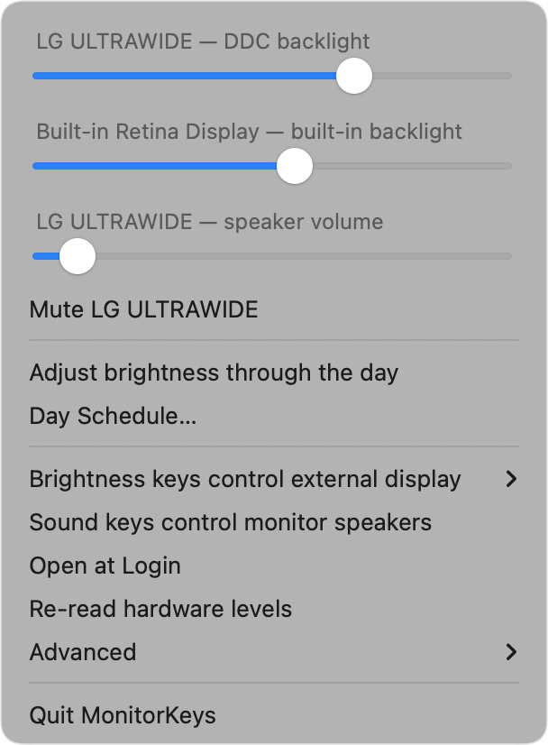
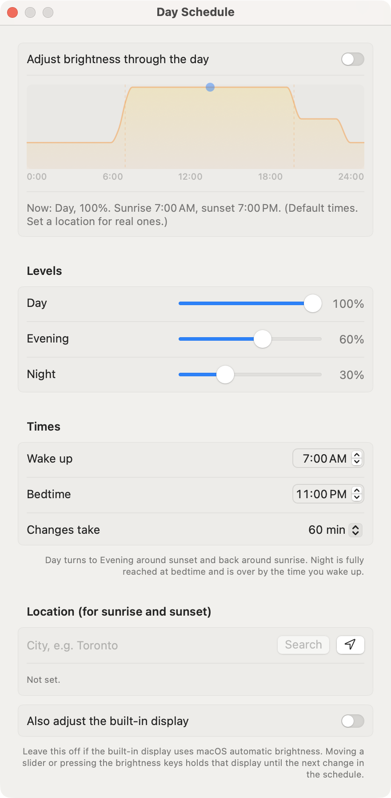
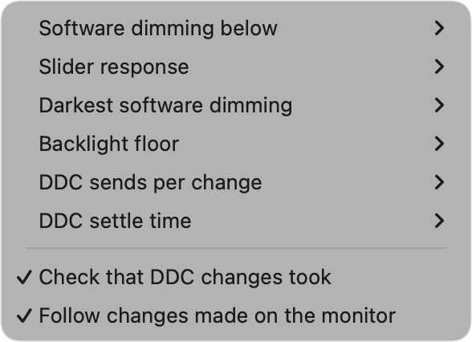

# MonitorKeys

A small macOS menu-bar app for external monitors on Apple Silicon:

- **Brightness:** one slider per display. It drives the monitor's backlight over DDC/CI, then dims
  further below the backlight's minimum with a dark overlay, which leaves colour apps such as f.lux
  alone. The overlay doesn't dim the pointer, the screen saver, the lock screen, or a game that
  takes over the whole display.
- **Brightness keys:** F1/F2 control the external display under the pointer, or the one with the
  active window. The built-in display stays with macOS.
- **Monitor speakers:** a volume slider and mute, plus volume and mute keys, while the Mac plays through the
  monitor (DisplayPort/HDMI audio that macOS can't control).
- **Day schedule:** brightness follows sunrise and sunset, with Day, Evening and Night levels and a
  bedtime. A manual change holds until the next transition. **Resume** returns to the schedule, and
  **Use … as the Day/Evening/Night level** makes the held brightness the current period's level.
- **Open at Login:** a menu toggle that registers the app as a macOS login item.

<p>
  
  
</p>

## Install

1. Download `MonitorKeys.zip` from [Releases](../../releases/latest).
2. Unzip it and move `MonitorKeys.app` to `/Applications`.
3. The app isn't notarized, so clear the download flag once before opening it:

```sh
xattr -dr com.apple.quarantine /Applications/MonitorKeys.app
open /Applications/MonitorKeys.app
```

Requires macOS 14+ on Apple Silicon.

## Build

Requires Swift 6.

```sh
scripts/make-signing-cert.sh   # optional, once: local signing so Accessibility permission survives rebuilds
scripts/build-app.sh           # → build/MonitorKeys.app
scripts/make-icon.sh           # only after editing scripts/make-icon.swift: redraws Resources/AppIcon.icns
open build/MonitorKeys.app
swift test
```

The keyboard features need Accessibility permission (System Settings → Privacy & Security → Accessibility).

## Diagnostics

```sh
.build/release/MonitorKeys --probe                    # list displays, read backlight and speaker levels
.build/release/MonitorKeys --probe --ddc-set 50       # write raw luminance
.build/release/MonitorKeys --probe --volume-set 10    # write raw speaker volume
.build/release/MonitorKeys --probe --ddc-queue 50     # write luminance as the app does: read back, resent if dropped
```

Bus timing can be overridden with the `MONITORKEYS_SENDS`, `MONITORKEYS_SETTLE_MS`, `MONITORKEYS_REPLY_MS` and `MONITORKEYS_READ_SENDS`
environment variables, and `MONITORKEYS_VERIFY=0` turns off the read-back. The menu's **Advanced** submenu has the same knobs.

## Advanced settings



| Setting | Default | What it does |
|---|---|---|
| Slider response | Linear | "Finer at the dark end" moves the backlight and dimming along brightness² instead of brightness, so low levels get more slider travel. Software dimming still starts where "Software dimming below" says. Apple panels stay linear: their scale is already perceptual. |
| Darkest software dimming | 15% | How dark the overlay gets at 0: 15%, 10% or 5%. Never black, because the overlay also covers the menu bar. |
| Software dimming below | 30% | Where the backlight reaches its floor and the overlay takes over. |
| Backlight floor | 0% | Lowest backlight level ever sent, for monitors whose low levels flicker. |
| DDC sends per change, settle time | Twice, 20 ms | Bus timing for monitors that drop or garble commands. |
| Check that DDC changes took | On | Once a change settles (250 ms), reads the monitor back and sends the value again, twice, if it didn't take. |
| Follow changes made on the monitor | On | Reads DDC monitors every 30 s (needs "Check that DDC changes took"). A level changed with the monitor's buttons or another app holds the schedule until its next transition, as on Apple panels, and shows on the slider. |

After the Mac wakes, each DDC monitor is sent its level again, since some come back at a level of their own.

## Notes

- **Commands are sent twice by default.** Some monitors silently drop a single DDC write, and setting a
  value twice is harmless.
- **Monitor support varies.** The monitor must support DDC/CI, and not every monitor exposes speaker volume
  (VCP 0x62) or mute (0x8D).
- **Tested on** an M5 MacBook Pro with an LG UltraWide, macOS 26.
